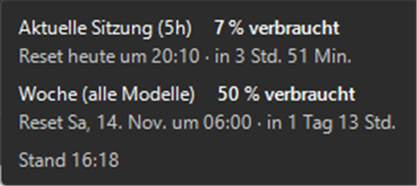
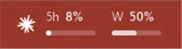
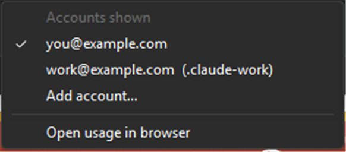

# Claude Usage Widget for Windows 11

Shows how much of your **Claude plan limits** you have used – the rolling **5‑hour session** and the **weekly** limit – right in the Windows 11 taskbar and as a widget in the Windows Widgets board.


> **Unofficial project.** See [Unofficial & disclaimer](#unofficial--disclaimer) before you install it.

## Features

- **Lives in the taskbar** next to the weather button – no window, no tray icon. Click it to open the Widgets board, right‑click for a link to your usage page.
- **Hover for details**: both limits with the exact reset time and how long until then.

  
- **Real Widgets‑board widget** (small and medium size) with both limits, reset times and an "Open in browser" button.
- **Four looks**, switchable under *Widgets board → … → Customize widget*:

  | Rings | Bars |
  |---|---|
  |  |  |
  |  |  |

  Options: rings or bars · text colour (automatic / light / dark) · wide (5h and week side by side) · compact ("W" instead of "Week") · show reset times · show logo.
- **Several accounts**: right‑click the taskbar display and tick which Claude Code logins to show – see [Multiple accounts](#multiple-accounts).
- **Fits any taskbar colour**: the text colour follows the Windows theme automatically, or pick light / dark yourself if your taskbar uses an accent colour. DPI scaling and English / German UI (depending on the Windows display language) are handled too.
- **Gentle on the API**: one request every **2 minutes**, shared by the taskbar and the widget. If the server answers *429 Too Many Requests* the wait doubles (4 → 8 minutes) and never exceeds 8 minutes.

## Requirements

- Windows 11
- [Claude Code](https://code.claude.com) installed and **signed in with a Claude Pro / Max subscription** – the widget reads the login Claude Code stores on your PC
- **Developer Mode** turned on (Settings → System → For developers). The release is not signed by a store certificate, so Windows only installs it in developer mode.
- Windows App Runtime 1.8 (x64). It is already present on most up‑to‑date Windows 11 PCs; if the installer complains, get it from [Microsoft](https://learn.microsoft.com/windows/apps/windows-app-sdk/downloads).

## Install

1. Download `ClaudeUsageWidget-<version>.zip` from [Releases](../../releases) and extract it.
2. Right‑click `Install.ps1` → **Run with PowerShell**
   (or `powershell -ExecutionPolicy Bypass -File Install.ps1`).
3. The usage display appears in the taskbar. To add the widget: press **Win + W** → **+** → **Claude Usage**.

To update, run the new release's `Install.ps1` – a pinned widget stays where it is.
To remove everything, run `Uninstall.ps1`.

Autostart is on by default; you can turn it off in Task Manager → *Startup apps*.

## Multiple accounts

Claude Code keeps one login per config folder: `%USERPROFILE%\.claude` by default, or the folder `CLAUDE_CONFIG_DIR` points to. A second account is usually run like this:

```powershell
$env:CLAUDE_CONFIG_DIR = "$HOME\.claude-work"
claude
```

- The widget finds these logins by itself: `.claude`, `CLAUDE_CONFIG_DIR` and every `%USERPROFILE%\.claude*` folder that contains a login.
- **Right‑click** the taskbar display: all logins are listed by their email – **tick the ones you want to see**. At least one stays ticked.

  
- **Add account…** lets you pick a login folder somewhere else.
- Each account gets its own block in the taskbar (separated by a thin line), its own section in the tooltip and in the widget. The logo is shown once.
- Every account is fetched and backs off on its own, so one failing login doesn't hold up the others. A login that fails shows **⚠ Error** in the taskbar; hover for the reason.

> The Claude desktop app keeps its login separately and can't be added – sign in to Claude Code with that account too.

## Advanced settings

Everything you can change in *Customize widget* is stored in `settings.json` in the app's local data folder
(`%LOCALAPPDATA%\Packages\ClaudeUsageWidget_…\LocalCache\Local\ClaudeUsageWidget\`). Two extra keys exist there only:

| Key | Values | Effect |
|---|---|---|
| `Language` | `"auto"` (default), `"en"`, `"de"` | UI language; `auto` follows the Windows display language. Takes effect after restarting the app. |
| `DemoEmails` | `true` / `false` | Shows `you@example.com`, `work@example.com`, … instead of the real account emails – handy for screenshots or streaming. |

## How it works

- Every 2 minutes, for each ticked account, the app reads the OAuth access token from that account's Claude Code login file
  (`.credentials.json` in its config folder, e.g. `%USERPROFILE%\.claude\.credentials.json`) and calls
  `GET https://api.anthropic.com/api/oauth/usage` with it – the same endpoint Claude Code's own `/usage` command uses.
- The app has no login of its own. Tokens are created and renewed only by Claude Code. When a token has less than 5 minutes left (or the server rejects it), the widget runs `claude auth status` in the background – Claude Code then renews its own login (no model request is sent). If Claude Code isn't installed where the widget can find it, or the login can't be renewed, the widget shows "Login expired" until you open Claude Code.
- The response contains the utilisation (in %) and reset time of the 5‑hour and the weekly window. That's all the app shows.
- The taskbar display is a small transparent window embedded in the taskbar; the widget is a regular Windows App SDK widget provider.

## Privacy

- **Read only.** The login files are only read. Account emails are taken from Claude Code's local `.claude.json` and only shown on your screen. The app never refreshes, changes, stores or copies your token itself – renewal is left to Claude Code (see above).
- **Only Anthropic.** The token is sent to `api.anthropic.com` and nowhere else. There is no telemetry, no analytics, no other server.
- **Local data.** The last usage numbers (`cache.json`) and your display settings (`settings.json`) are kept in the app's local data folder and removed when you uninstall.
- If Claude Code's token has expired, the widget says so – open Claude Code once and it renews the login itself.

## Unofficial & disclaimer

**This is an unofficial community project. It is not made, endorsed, supported or reviewed by Anthropic.** "Claude" and "Claude Code" are trademarks of Anthropic, PBC; they are used here only to describe what the app works with. The spark logo is this project's own drawing, not Anthropic's logo.

Please be aware of the following before you use it:

- **Undocumented endpoint.** `/api/oauth/usage` is not a public, documented API. Anthropic can change or remove it at any time, and the widget may stop working without warning.
- **Use of your Claude Code login.** The widget reads the **OAuth access token** that your own Claude Code installation stored after you signed in, and sends it itself (as a bearer token) to `api.anthropic.com` – i.e. it uses your Claude subscription login outside of Claude Code. With several accounts this applies to every ticked account. Anthropic's [terms for Claude Code](https://code.claude.com/docs/en/legal-and-compliance.md) say that subscription (OAuth) logins are meant for Claude Code and Anthropic's own apps. Whether a small, read‑only, local status display like this one is acceptable is **your call** – read the terms yourself. This project makes no claim that it is permitted and accepts no liability for any consequences for your account.
- **No guarantee of accuracy.** The numbers are whatever the endpoint returns; for authoritative values check [claude.ai/settings/usage](https://claude.ai/settings/usage).
- The software is provided "as is", without warranty of any kind (see [LICENSE](LICENSE)).

## Build from source

Requirements: .NET 10 SDK, Windows 11 with Developer Mode.

```powershell
# build, register as a developer package and start (updates in place)
powershell -ExecutionPolicy Bypass -File install.ps1

# build a release zip into dist\
powershell -ExecutionPolicy Bypass -File tools\make-release.ps1 -Version 1.0.0

# re-render the icons from AppLogo.cs / the widget picker preview
dotnet run --project tools\RenderIcons
powershell -ExecutionPolicy Bypass -File tools\make-assets.ps1
```

| File | What it does |
|---|---|
| `Program.cs` | start‑up, usage fetching (shared cache, 2 min interval, back‑off), settings, right‑click menu |
| `Accounts.cs` | finds Claude Code logins and names them |
| `TaskbarWidget.cs` | the display embedded in the taskbar (all four looks, right‑click menu) |
| `WidgetProvider.cs` | Widgets‑board provider: widget card and *Customize widget* dialog |
| `HoverTip.cs` | the tooltip with reset times |
| `AppLogo.cs` | the spark logo (own design), drawn as vectors |
| `Strings.cs`, `Strings/` | English / German texts |
| `Package.appxmanifest` | app package, widget registration, startup task |

## License

[MIT](LICENSE)
